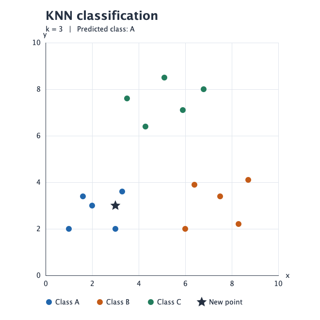

### 6. Java: K-Nearest Neighbors (KNN) Classifier

- Реализовать приложение классификации точек методом ближайших соседей (KNN)
  - предусловие: множество двумерных точек (Point + Class label)
  - вход: точка без указания класса
  - выход: класс новой точки, подаваемой на вход
- Не использовать специализированные библиотеки для классификации данных
- Построить график (в виде изображения) для набора точек минимум трех классов

#### Реализация

В программе задано 15 точек, по пять для каждого класса: `A`, `B` и `C`.
Для новой точки вычисляются евклидовы расстояния до точек набора. Из них
выбираются `k` ближайших, а класс определяется по числу голосов соседей.
Если несколько классов набрали поровну голосов и делят первое место,
побеждает класс с ближайшим соседом среди них.

Для графика используются Java2D и ImageIO из стандартной библиотеки Java.
Цвет точек показывает их класс, звезда обозначает новую точку.

#### Запуск

Из папки лабораторной работы с JDK 23 или новее:

```sh
java -Djava.awt.headless=true app/src/main/java/org/example/App.java 3 3
```

Первые два аргумента — координаты `x` и `y`. Третий аргумент задаёт `k`
от 1 до 15. По умолчанию `k = 3`. Программа выводит класс в консоль и
сохраняет график в `knn.png` в текущей папке. При повторном запуске файл
перезаписывается.

#### Проверка и результаты

| Новая точка | `k` | Полученный класс |
| --- | ---: | :---: |
| (3; 3) | 3 | A |
| (7,5; 3) | 3 | B |
| (5; 7) | 3 | C |

Тесты проверяют большинство среди ближайших соседей, выбор класса при
ничьей и ошибку при слишком большом `k`.

График для точки (3; 3):


