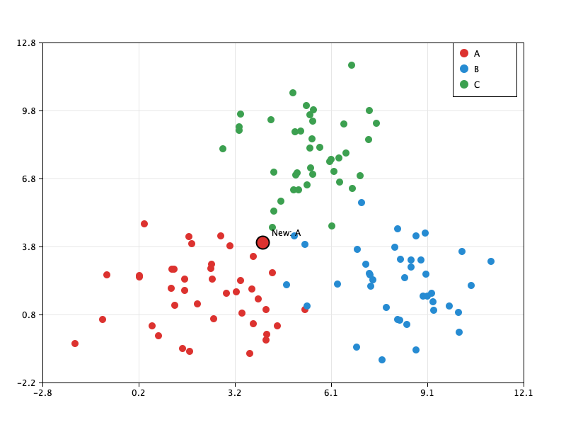

# 6. Java: K-Nearest Neighbors (KNN) Classifier

## Задание

- Реализовать приложение классификации точек методом ближайших соседей (KNN)
  - предусловие: множество двумерных точек (Point + Class label)
  - вход: точка без указания класса
  - выход: класс новой точки, подаваемой на вход
- Не использовать специализированные библиотеки для классификации данных
- Построить график (в виде изображения) для набора точек минимум трех классов

## Что делает программа

1. Генерирует обучающую выборку: три класса `A`, `B`, `C` (по 40 точек в каждом).
2. Классифицирует новую точку методом KNN (`k = 5`).
3. Выводит класс в консоль и сохраняет график в `plot.png`.

Классификатор написан с нуля, без библиотек для машинного обучения. График рисуется стандартными `java.awt` и `javax.imageio`.



На графике показана точка `(4, 4)`: она оказалась в классе `A` и нарисована крупным кружком с чёрной обводкой и подписью `New: A`.

## Запуск

Требуется JDK 23 (задан в `app/build.gradle`) и Gradle.

```
gradle run                  # новая точка по умолчанию: (4, 4)
gradle run --args="5 5"     # своя точка: x y
gradle test                 # тесты
```

Результат:

```
Point (4.0, 4.0) -> class A
Plot saved to plot.png
```

Картинка `plot.png` сохраняется в каталоге `app/` и перезаписывается при каждом запуске. При неверных аргументах программа выводит `Usage: App [x y]` и завершается с кодом 1.

## Как работает алгоритм

Для новой точки:

1. Считается евклидово расстояние `sqrt((x1 - x2)² + (y1 - y2)²)` до каждой точки обучающей выборки.
2. Выбираются `k` ближайших: `k` раз ищется ближайшая точка среди ещё не выбранных, она добавляется в результат и убирается из рабочей копии списка (исходный список не меняется).
3. Среди `k` соседей голосованием определяется самый частый класс.

**Выбор `k`.** `k = 5`: при малом `k` результат чувствителен к отдельным выбросам, при большом классы «размываются». Классов три, поэтому нечётное `k` ничьих не исключает, но делает их реже.

**Ничья.** Если несколько классов набрали одинаковое число голосов, побеждает класс ближайшего из соседей. Соседи хранятся в порядке возрастания расстояния, поэтому проверяется первый подходящий.

**Ограничения на `k`.** Конструктор `KnnClassifier` выбрасывает `IllegalArgumentException`, если `k <= 0` или `k` больше размера выборки.

## Данные

Данные генерируются, а не читаются из файла. Для каждого класса задаются центр, разброс и число точек, а координаты равны `центр + nextGaussian() * разброс`:

| Класс | Центр    | Разброс | Точек |
|-------|----------|---------|-------|
| A     | (2, 2)   | 1.5     | 40    |
| B     | (8, 2)   | 1.4     | 40    |
| C     | (5, 8)   | 1.3     | 40    |

Используется один `Random` с фиксированным `seed = 42`, поэтому выборка и график воспроизводимы. Облака немного перекрываются, поэтому на границах классов видно, как работает KNN.

## Структура проекта

```
app/src/main/java/ru/khramov/
├── App.java                  точка входа
├── KnnClassifier.java        алгоритм KNN
├── data/
│   ├── ClassSpec.java        описание класса для генерации
│   └── DataGenerator.java    генератор гауссовых облаков
├── plot/
│   └── PlotRenderer.java     рисование графика в PNG
└── point/
    ├── Point.java            двумерная точка, расстояние
    └── LabeledPoint.java     точка с меткой класса
```

## Тесты

JUnit 4, 28 тестов: классификатор (разные `k`, ничья, ближайшая точка не первая в списке, неверные параметры), генератор (количество, метки, среднее около центра, воспроизводимость), рисование (перевод координат, создание файла), разбор аргументов.
